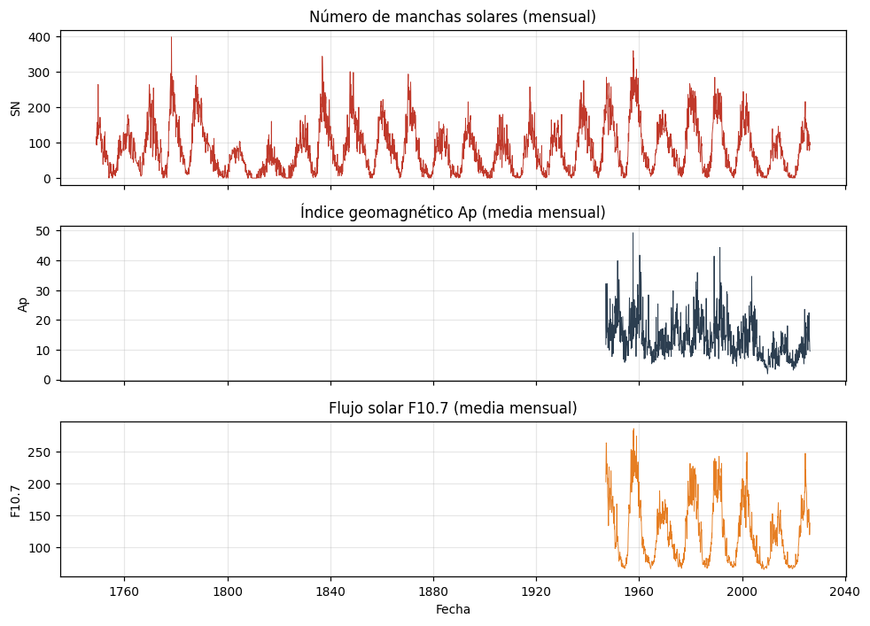
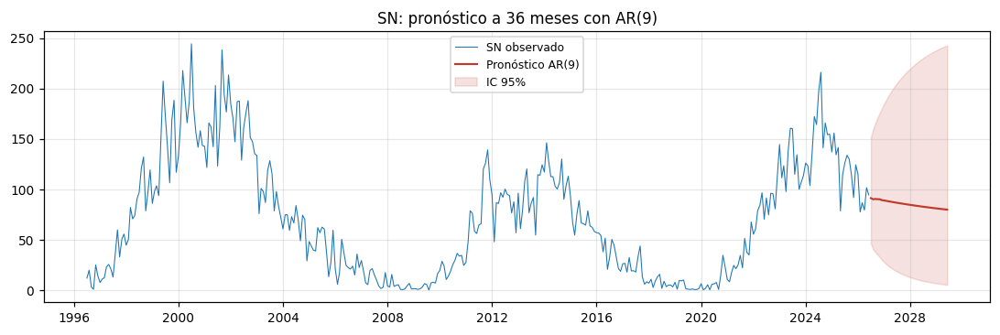

# Del ciclo solar a la actividad geomagnética: modelado y pronóstico del índice Ap

Análisis de series temporales de clima espacial: ¿cuánto de la actividad geomagnética de la Tierra se puede explicar y pronosticar a partir de la actividad del Sol?

Trabajo final de **Series Temporales**, Licenciatura en Ciencia de Datos (UCA, 2026).



## Datos

| Serie | Fuente | Frecuencia | Período |
|---|---|---|---|
| Número de manchas solares (SN) | [SILSO, Royal Observatory of Belgium](https://www.sidc.be/SILSO/) | Mensual | 1749 – 2026 |
| Índice geomagnético Ap y flujo solar F10.7 | [GFZ Potsdam](https://kp.gfz.de/) | Diaria | 1932 – 2026 |

## Resultados principales

- **Ciclo solar en la ACF:** el número de manchas es estacionario (ADF y KPSS coinciden) y su correlograma muestra el ciclo de Schwabe de **10,7 años** (rezago 128). Un AR(9) pronostica la fase descendente del ciclo actual.
- **Estacionalidad equinoccial:** el Ap tiene máximos en marzo y septiembre. Un SARIMA con s = 12 baja el AIC de **5688 a 5535**.
- **Causalidad unidireccional:** Granger y VAR confirman Sol → Tierra (SN → Ap, p < 10⁻⁶) sin retroalimentación. La función impulso-respuesta pica en el **mes 22**, en la fase descendente del ciclo.
- **Volatilidad:** efectos ARCH fuertes (p ≈ 10⁻³⁰). Se compararon ARCH, GARCH, EGARCH y GJR-GARCH con errores t. Se eligió **GARCH(1,1)** (persistencia 0,987) por parsimonia, porque el término asimétrico no fue significativo.
- **Backtest integrador:** el **nivel** del Ap sí es predecible (el AR le gana al random walk por **7,9 % de RMSE**), mientras que la volatilidad de corto plazo se describe bien dentro de la muestra (corr. 0,82) pero cuesta pronosticarla fuera de ella.



## Metodología

1. Análisis exploratorio y descomposición STL
2. Estacionariedad: ADF y KPSS
3. Correlograma y test de Ljung-Box
4. Modelos ARMA/ARIMA y pronóstico del ciclo solar
5. SARIMA para la estacionalidad del Ap
6. Causalidad de Granger, VAR y funciones impulso-respuesta
7. Familia ARCH/GARCH con errores t de Student
8. Backtest fuera de muestra: nivel contra volatilidad

**Limitación reportada:** un solo GARCH(1,1) no captura la memoria larga de la volatilidad geomagnética (recurrencia solar de 27 días y ciclo de 11 años).

## Estructura

```
├── notebook_actividad_geomagnetica.ipynb   # Análisis completo, reproducible
├── informe/informe_actividad_geomagnetica.pdf
├── data/                                   # Datos públicos SILSO y GFZ
└── img/
```

## Cómo correrlo

```bash
pip install numpy pandas matplotlib scipy statsmodels arch
jupyter notebook notebook_actividad_geomagnetica.ipynb
```

## Stack

Python · pandas · NumPy · statsmodels (ARIMA, SARIMAX, VAR, STL) · arch (GARCH) · SciPy · Matplotlib

---

**Juan Cruz Montero** · Estudiante de Lic. en Ciencia de Datos (UCA) · [LinkedIn](https://www.linkedin.com/in/juan-cruz-montero-a14474431)
